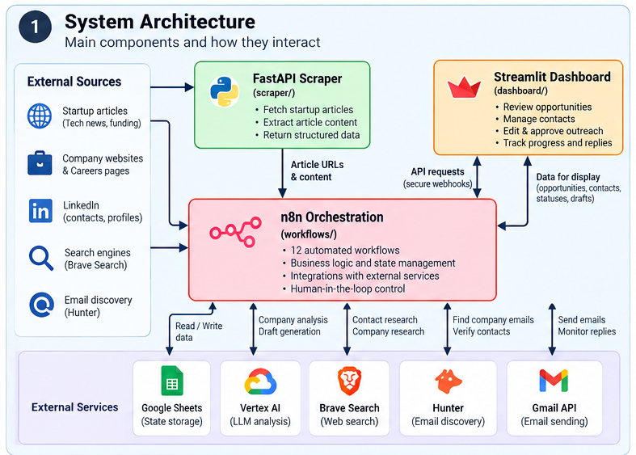
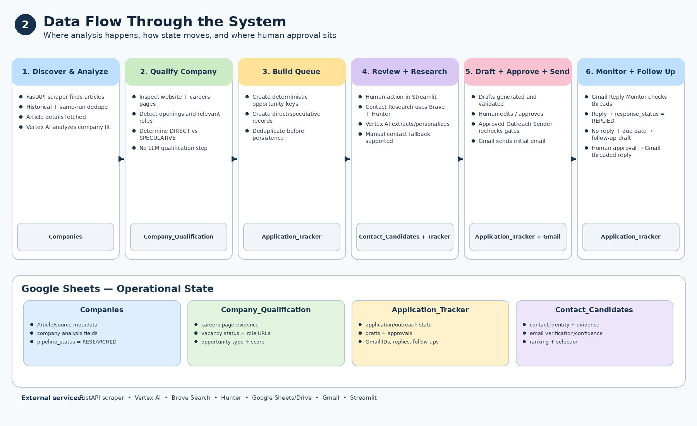
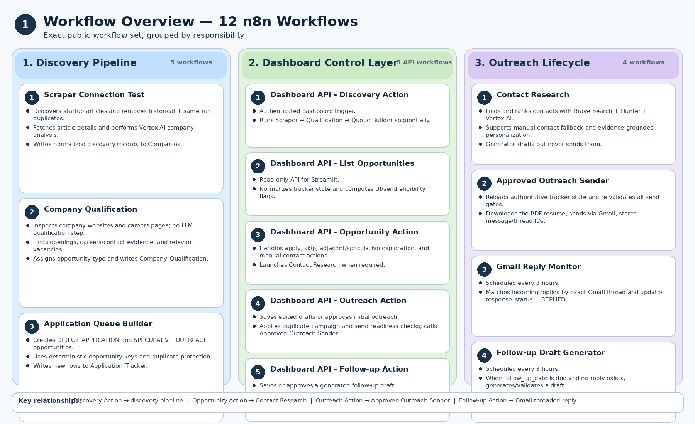
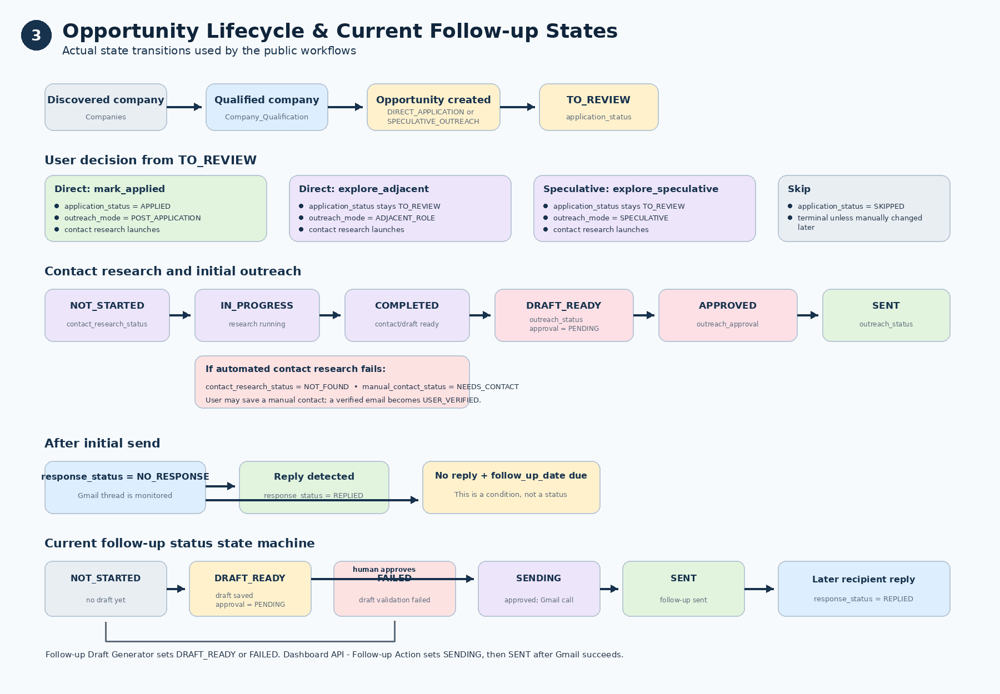
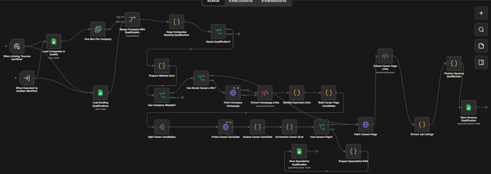
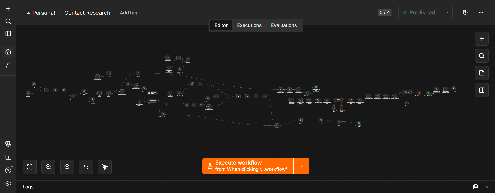
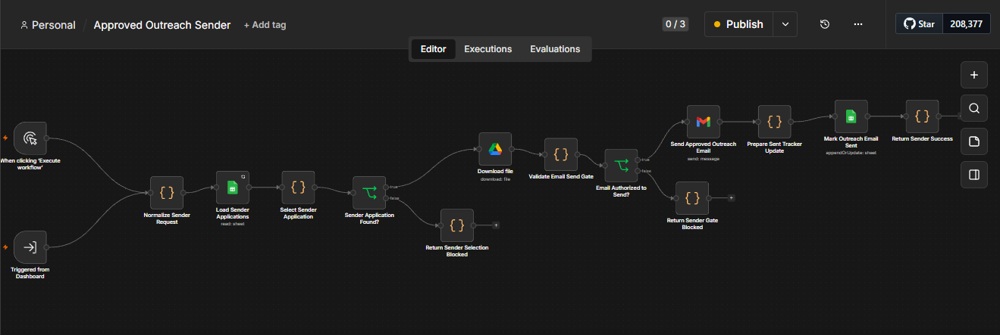

# AI-Powered Job Discovery & Outreach Automation Platform

A self-hosted, human-in-the-loop platform for discovering promising companies, qualifying opportunities, researching contacts, generating evidence-grounded outreach, tracking application state, and managing replies and follow-ups.

Built with **Python, n8n, Streamlit, FastAPI, Vertex AI, Google Sheets, Gmail, Docker, and Google Cloud**.

> **Portfolio status:** sanitized public version. Production credentials, private runtime state, real contact data, and real application records are intentionally excluded.

---

## At a Glance

| Area | What the system does |
|---|---|
| Discovery | Finds recent startup/company signals and removes previously processed articles |
| Qualification | Inspects company websites and careers pages and distinguishes direct vs speculative opportunities |
| Application tracking | Creates deterministic opportunity records and manages state across the lifecycle |
| Contact research | Finds relevant contacts, preserves evidence, verifies emails, and ranks candidates |
| Outreach | Generates separate email and LinkedIn drafts with conservative, evidence-grounded prompts |
| Human approval | Requires explicit review before initial outreach or follow-up is sent |
| Reply monitoring | Tracks Gmail threads, detects responses, and prevents inappropriate follow-ups |
| Interface | Uses a Streamlit dashboard as the human control layer |

---

## System Architecture



The platform separates concerns across several services:

- **Streamlit** — human review and actions
- **n8n** — orchestration, validation, integrations, and state transitions
- **FastAPI scraper** — article discovery and extraction
- **Google Sheets** — lightweight operational state store
- **Vertex AI** — structured analysis and drafting
- **Brave Search + Hunter** — contact research and email evidence
- **Gmail** — approved sending and reply monitoring
- **Docker + Google Cloud** — original self-hosted deployment
- **Tailscale** — private administrative access in the original deployment

Detailed architecture: [`docs/architecture.md`](docs/architecture.md)

---

## Why I Built It

International AI/data job searching is more than checking job boards. It repeatedly involves:

- finding growing companies,
- checking careers pages,
- deciding whether an opportunity is relevant,
- researching possible contacts,
- preparing tailored outreach,
- tracking application state,
- monitoring replies,
- and deciding when to follow up.

I built this project to turn that fragmented process into one coordinated system while keeping a **human approval boundary before external communication**.

The goal is not autonomous mass application. Automation handles repetitive research, normalization, scoring, drafting, and state management; the user remains responsible for important decisions.

---

## End-to-End Flow



A simplified lifecycle is:

```text
Discover companies
        ↓
Analyze company fit
        ↓
Inspect careers pages
        ↓
Create direct/speculative opportunities
        ↓
Review in Streamlit
        ↓
Research contacts
        ↓
Generate email + LinkedIn drafts
        ↓
Human review / approval
        ↓
Send approved email
        ↓
Monitor Gmail thread
        ↓
Reply or follow-up lifecycle
```

---

## Workflow Organization



The repository contains **12 n8n workflows** grouped into three areas.

### Discovery & Qualification

`workflows/discovery/`

- `Scraper Connection Test`
- `Company Qualification`
- `Application Queue Builder`

This layer discovers companies, evaluates source material, inspects careers pages, and creates direct or speculative opportunities.

### Dashboard API

`workflows/dashboard-api/`

- `Dashboard API - Discovery Action`
- `Dashboard API - List Opportunities`
- `Dashboard API - Opportunity Action`
- `Dashboard API - Outreach Action`
- `Dashboard API - Follow-up Action`

These workflows provide authenticated webhook endpoints used by the Streamlit interface.

### Contact & Outreach

`workflows/outreach/`

- `Contact Research`
- `Approved Outreach Sender`
- `Follow-up Draft Generator`
- `Gmail Reply Monitor`

This layer handles contact discovery, evidence gathering, drafting, sending gates, reply detection, and follow-up preparation.

Full workflow documentation: [`docs/workflow-design.md`](docs/workflow-design.md)

---

## Opportunity Lifecycle



The system deliberately uses multiple state dimensions rather than one overloaded status field.

Examples include:

```text
application_status
opportunity_type
outreach_mode
contact_research_status
outreach_status
outreach_approval
draft_final_status
response_status
follow_up_status
```

This allows cases such as direct applications, adjacent-role outreach, speculative outreach, manual-contact fallback, reply detection, and follow-up management to evolve independently.

Data-model documentation: [`docs/data-model.md`](docs/data-model.md)

---

## Human-in-the-Loop by Design

The project intentionally separates **automation** from **authorization**.

The system can automatically:

- discover and normalize companies,
- analyze source content,
- inspect careers pages,
- create opportunities,
- research contacts,
- verify contact evidence,
- generate outreach drafts,
- monitor replies,
- detect due follow-ups.

The user controls:

- whether to apply,
- whether to explore adjacent or speculative outreach,
- whether to replace an automatically selected contact,
- editing drafts,
- approving initial outreach,
- approving follow-ups.

Most importantly:

```text
LLM generation != authorization to send
```

---

## Engineering Highlights

### 1. Google Sheets rate-limit redesign

The original implementation performed sheet lookups inside item-by-item loops and began hitting `HTTP 429` responses.

It was redesigned to:

```text
Load existing rows once
        ↓
Build an in-memory Set
        ↓
Normalize incoming keys
        ↓
Compare locally
        ↓
Process only new records
```

This reduced external API calls and improved idempotency.

### 2. LLM request pacing

Company analysis initially sent model requests too quickly.

The workflow was changed to:

```text
Loop Over Items
→ Analyze
→ Wait
→ Next item
```

This traded a small amount of execution speed for predictable reliability.

### 3. Historical + same-run deduplication

The system protects against both:

- records that already exist from previous executions;
- duplicate records generated during the current execution.

Normalized business keys are used for:

- article URLs,
- company domains,
- vacancies,
- opportunity keys,
- contact emails,
- LinkedIn URLs,
- outreach campaigns.

### 4. Explicit opportunity types

The system distinguishes:

```text
DIRECT_APPLICATION
SPECULATIVE_OUTREACH
```

This prevents speculative networking from being represented as though a real vacancy exists.

### 5. Evidence-grounded AI behavior

Prompts explicitly prohibit unsupported assumptions such as:

- inventing company technologies,
- inventing vacancies,
- assuming visa sponsorship,
- assuming hiring plans,
- overstating candidate-company fit,
- fabricating personalization evidence.

### 6. Defense-in-depth email sending

An email is not sent merely because a draft exists.

The sender rechecks conditions such as:

```text
outreach_approval = APPROVED
outreach_status = DRAFT_READY
draft_final_status = READY
```

plus:

- valid email,
- acceptable confidence,
- resume availability,
- duplicate campaign state,
- previous send state.

### 7. Manual fallback instead of fabricated success

If automatic contact research cannot find a reliable person, the system can enter states such as:

```text
contact_research_status = NOT_FOUND
manual_contact_status = NEEDS_CONTACT
```

The user can then provide a manually verified contact rather than forcing the automation to invent one.

---

## Streamlit Dashboard

Source: [`dashboard/`](dashboard/)

The dashboard is the human-facing control layer.

Main views:

- **Active Opportunities**
- **Manual Outreach**
- **Processed**
- **Follow-ups**
- **Replies**

The dashboard communicates with n8n through authenticated webhook endpoints rather than directly editing the underlying Google Sheets state.

---

## FastAPI Scraper

Source: [`scraper/`](scraper/)

Main endpoints:

```text
GET /health
GET /discover-test
GET /article-details
```

The scraper is responsible for retrieval and parsing only. Qualification, state transitions, contact research, and sending remain in n8n.

---

## Data Model

The platform uses four main datasets:

```text
Companies
Company_Qualification
Application_Tracker
Contact_Candidates
```

The public repository includes synthetic workflow-aligned examples:

- [`companies.sample.csv`](samples/companies.sample.csv)
- [`company-qualification.sample.csv`](samples/company-qualification.sample.csv)
- [`application-tracker.sample.csv`](samples/application-tracker.sample.csv)
- [`contact-candidates.sample.csv`](samples/contact-candidates.sample.csv)

These files reproduce the real workflow schemas using fictional companies, contacts, and opportunities.

---

## Selected Workflow Screenshots

### Company Qualification



### Contact Research



### Approved Outreach Sender



Additional workflow screenshots are available under [`assets/screenshots/workflows/`](assets/screenshots/workflows/).

---

## Demo

A narrated end-to-end demo has been recorded showing:

```text
Discovery
→ Qualification
→ Opportunity Review
→ Contact Research
→ Selected Contact
→ Outreach Drafting
→ Human Approval
→ Manual Fallback
```

The demo is available here:

[Watch the full demo](https://youtu.be/knn3NYxtOrQ)

The full demo is intentionally not committed directly to the repository to avoid storing a large video file in Git history.

---

## Repository Structure

```text
ai-job-outreach-platform/
│
├── dashboard/                  # Streamlit control interface
├── scraper/                    # FastAPI discovery service
│
├── workflows/
│   ├── discovery/
│   ├── dashboard-api/
│   └── outreach/
│
├── samples/                    # Synthetic workflow-aligned datasets
│
├── assets/
│   ├── diagrams/
│   └── screenshots/
│       └── workflows/
│
├── docs/
│   ├── architecture.md
│   ├── data-model.md
│   ├── workflow-design.md
│   ├── deployment.md
│   ├── security.md
│   └── setup.md
│
├── .env.example
├── .gitignore
└── README.md
```

---

## Documentation

| Document | Purpose |
|---|---|
| [`docs/architecture.md`](docs/architecture.md) | Components, service boundaries, and system/data flow |
| [`docs/workflow-design.md`](docs/workflow-design.md) | Detailed design of all 12 n8n workflows |
| [`docs/data-model.md`](docs/data-model.md) | Sheets, keys, state fields, and relationships |
| [`docs/setup.md`](docs/setup.md) | Local configuration, credentials, imports, and activation order |
| [`docs/deployment.md`](docs/deployment.md) | Original Docker/GCP deployment architecture |
| [`docs/security.md`](docs/security.md) | Secrets, private runtime state, approval gates, and public-repo boundaries |

---

## Setup

Start with:

[`docs/setup.md`](docs/setup.md)

At a high level:

```text
1. Create the four Google Sheets schemas
2. Configure Google / Gmail / Vertex AI credentials
3. Configure Brave Search and Hunter
4. Import the 12 sanitized n8n workflows
5. Replace the Google Sheet and GCP placeholders
6. Re-link Execute Workflow nodes
7. Configure dashboard webhook authentication
8. Run the FastAPI scraper
9. Run the Streamlit dashboard
10. Test workflows manually before enabling schedules
```

Example dashboard configuration is available in:

```text
.env.example
```

Production secrets belong in a private `.env` or managed secret store, never in the repository.

---

## Security & Privacy

The public repository intentionally excludes:

- OAuth tokens and API keys,
- n8n credential records,
- n8n SQLite/runtime backups,
- Docker inspect output,
- production Google Sheet IDs,
- production GCP/Tailscale identifiers,
- real recruiter/contact data,
- real application records,
- real Gmail thread/message data.

The project also uses:

- authenticated dashboard webhooks,
- email-confidence gates,
- explicit user approval,
- duplicate-campaign protection,
- reply-aware follow-up logic,
- deterministic state validation before sending.

Full security notes: [`docs/security.md`](docs/security.md)

---

## Technology Stack

| Layer | Technologies |
|---|---|
| Interface | Streamlit |
| Orchestration | n8n |
| Backend services | Python, FastAPI |
| AI | Vertex AI, structured LLM extraction, prompt engineering |
| State | Google Sheets |
| Contact research | Brave Search API, Hunter API |
| Messaging | Gmail API, Google Drive |
| Infrastructure | Docker, Google Cloud, Tailscale |
| Integration style | REST APIs, authenticated webhooks |

---

## What I Learned

The main challenge was not building individual automation nodes. It was coordinating several services into a reliable, stateful system.

The project required reasoning about:

- rate limits,
- idempotency,
- deterministic identifiers,
- state transitions,
- API failure behavior,
- data quality,
- LLM uncertainty,
- evidence quality,
- duplicate outreach,
- human approval boundaries,
- privacy,
- and deployment security.

Those constraints turned the project from a simple workflow automation experiment into a broader **AI systems and workflow-engineering project**.

---

## Current Limitations / Future Improvements

This is a portfolio-grade prototype rather than a hardened multi-user SaaS product.

Potential future improvements include:

- migrate operational state from Google Sheets to PostgreSQL;
- add centralized secret management;
- publish a generalized Docker Compose deployment;
- add stronger user authentication and request signing;
- improve explicit fallback handling for external website-fetch failures;
- add automated tests for state transitions and workflow contracts;
- add CI secret scanning and linting;
- add centralized structured logging and monitoring.

---

## License

This project is licensed under the [MIT License](LICENSE).
